# Architecture

```mermaid
flowchart LR
  subgraph Sources["Sources (Acme Notes, the sandbox startup)"]
    GH[GitHub]:::real
    VC[Vercel deployments]:::real
    ST[Stripe test mode]:::real
    EV[Whydunit snippet<br/>events + rrweb recordings]:::real
    HD[Helpdesk + reviews]:::real
    AD[Ad platform<br/>SIMULATED]:::sim
    TV[Tavily news]:::real
    HO[Holidays, status pages]:::real
  end

  subgraph Ladder["Connector ladder (by evidence kind)"]
    T1[1 Official API / MCP]
    T2[2 Warehouse / PyAirbyte]
    T3[3 CSV export<br/>Nano maps columns]
    T4[4 Screen reading<br/>Nano Omni reads screenshots]
    T5[5 Public web]
    T6[6 Ask a human]
  end

  subgraph Team["Detectives (run concurrently)"]
    F[Funnel]
    D[Deploy]
    S[Session]
    P[Payments]
    A[Ads]
    V[Voice]
    W[World]
  end

  Sources --> Ladder --> Team
  Team -->|findings, hypotheses| L[Lead detective<br/>Nemotron Ultra]
  L -->|questions| Team
  L --> J{Judgement in code<br/>mechanism + timing}
  J --> SH[Shapley attribution<br/>+ bootstrap CIs]
  SH --> VD[Verdict]
  VD --> FX[Fixer<br/>PR, config, mitigation]
  FX -->|preview flows| RN[Browser runner<br/>Nebius Serverless Job]
  FX --> VF[Verifier + watcher]
  VF -->|recovered| CL[Case closed]
  VF -->|not recovered| L

  classDef real fill:#e8f4ec,stroke:#1f8a4c
  classDef sim fill:#fff4e5,stroke:#b5651d
```

## Where each model and Nebius service is used

| Where | What |
|---|---|
| **Nemotron 3 Nano** (Token Factory) | Detectives' tool-calling loops; clustering tickets and reviews by topic; mapping CSV columns; judging news relevance; writing the simulator's support tickets and reviews |
| **Nemotron 3 Super** | Each detective's final report (strict JSON, validated by code); reading code diffs; writing fix patches for pull requests (up to two revisions) |
| **Nemotron 3 Ultra** | The lead detective's verdict narrative, once per case (never looped), checked by the number validator |
| **Nemotron 3 Nano Omni** | Reading failure screenshots from the browser runner; describing session-replay keyframes; reading dashboard screenshots in the screen-reading tier |
| **Nebius Token Factory** | Every model call: OpenAI-compatible, with a cost meter per case, a disk cache, role fallbacks (Ultra → Super) and a per-case budget |
| **Nebius Serverless Jobs** | The browser runner (Playwright with Chromium, WebKit, Firefox): signup flows on every deployment and on fix previews, keyframe rendering, dashboard capture |

## What is computed by code (never by a model)

Change detection (seasonally matched, overdispersed Poisson; CUSUM for timing), funnel decomposition (LMDI, exact),
segment drill-down (mix vs rate), counterfactual attribution (exact Shapley over all subsets of supported
hypotheses, parametric bootstrap CIs, explicit unexplained share), session heuristics (rage clicks, dead clicks,
abandonment), finding validation (evidence must exist in the case; every number must match a computed metric) and the
judgement rule (a cause needs observed mechanism *and* matching timing).

## Data flow of a case

1. **Open**: by a person, or by the watcher when the headline metric has dropped beyond normal variance for 36 h.
2. **Investigate**: seven detectives fetch evidence by kind through the ladder; every bundle is pinned with its
   tier, and every analysis result is pinned as derived evidence.
3. **Cross-examine**: the lead merges proposals into hypotheses with effect specs and asks structured questions;
   answers bring new evidence or `cannot_determine`.
4. **Attribute and decide**: Shapley shares for supported hypotheses; verdict with "how we know", actions and
   "not checked".
5. **Fix and verify**: PR verified on a Vercel preview across five browsers; approval-gated merges and config
   changes; the watcher closes the case when each cause's metric is back in its baseline range.

Every step is an event in an append-only log, streamed to the case board over SSE and replayable at any speed.
